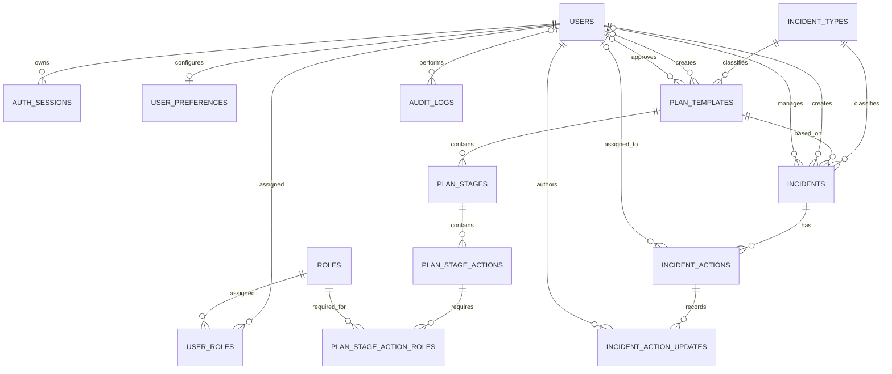

# Data Architecture

## Overview

Pit Stop Plans uses a single SQLite database at `backend/data/database.sqlite`.
The shared connection and SQLite settings are configured in `backend/data/db.js`;
the schema is created and migrated at application startup by
`backend/data/init.js`. Foreign-key enforcement is enabled on the shared
connection.

The schema has three main areas:

- **Identity and access:** users, operational roles, user-role assignments,
  authentication sessions, login throttling, and preferences.
- **Plan definition:** incident types, versioned plan templates, stages, stage
  actions, and the roles associated with those actions.
- **Incident execution and history:** incidents, their action instances, action
  updates, and audit records.

## Relationship overview

`LOGIN_ATTEMPTS` is keyed by email and is not linked to `USERS` by a foreign
key. `INCIDENT_ACTIONS.original_action_id` is a logical link to
`PLAN_STAGE_ACTIONS.id`; it is not declared as a foreign key. The application
uses that link to find the template action and its required roles.

## Tables

`PK` means primary key; `FK` identifies a foreign key and its target. Columns
not marked `NOT NULL` are nullable. Defaults are shown where defined.

### Identity and access

#### `users`

One account per user.

| Column | Definition |
|---|---|
| `id` | `INTEGER PK AUTOINCREMENT` |
| `email` | `TEXT NOT NULL UNIQUE` |
| `password` | `TEXT NOT NULL` — bcrypt password hash |
| `role` | `TEXT DEFAULT 'user'` — singular role text field |
| `active` | `INTEGER NOT NULL DEFAULT 1` |
| `token_version` | `INTEGER NOT NULL DEFAULT 0` |
| `created_at` | `DATETIME DEFAULT CURRENT_TIMESTAMP` |

`user_roles` is the normalized relation for assigning multiple roles to a user.
The `role` text column also remains in the schema.

#### `roles`

Reusable operational roles, such as roles assigned to users or required by
plan actions.

| Column | Definition |
|---|---|
| `id` | `INTEGER PK AUTOINCREMENT` |
| `name` | `TEXT NOT NULL UNIQUE` |
| `active` | `INTEGER NOT NULL DEFAULT 1` |

#### `user_roles`

Many-to-many junction between users and roles.

| Column | Definition |
|---|---|
| `user_id` | `INTEGER NOT NULL FK -> users.id ON DELETE CASCADE` |
| `role_id` | `INTEGER NOT NULL FK -> roles.id ON DELETE CASCADE` |
| Primary key | Composite: (`user_id`, `role_id`) |

#### `auth_sessions`

Server-side session/token records. The stored token value is a hash.

| Column | Definition |
|---|---|
| `id` | `INTEGER PK AUTOINCREMENT` |
| `user_id` | `INTEGER NOT NULL FK -> users.id ON DELETE CASCADE` |
| `token_hash` | `TEXT NOT NULL UNIQUE` |
| `expires_at` | `DATETIME NOT NULL` |
| `created_at` | `DATETIME NOT NULL DEFAULT CURRENT_TIMESTAMP` |
| `last_used_at` | `DATETIME` |
| `revoked_at` | `DATETIME` |

#### `login_attempts`

Tracks failed-login counts and temporary lockouts by email address. It has no
foreign key to `users`, so it can also represent addresses without a matching
account.

| Column | Definition |
|---|---|
| `email` | `TEXT PK` |
| `failed_attempts` | `INTEGER NOT NULL DEFAULT 0` |
| `locked_until` | `DATETIME` |
| `last_failed_at` | `DATETIME` |

#### `user_preferences`

One serialized preferences document per user.

| Column | Definition |
|---|---|
| `user_id` | `INTEGER PK FK -> users.id ON DELETE CASCADE` |
| `preferences` | `TEXT NOT NULL DEFAULT '{}'` |
| `created_at` | `DATETIME DEFAULT CURRENT_TIMESTAMP` |
| `updated_at` | `DATETIME DEFAULT CURRENT_TIMESTAMP` |

The application serializes/deserializes the preferences value as JSON.

### Plan definition

#### `incident_types`

Catalog of incident categories.

| Column | Definition |
|---|---|
| `id` | `INTEGER PK AUTOINCREMENT` |
| `name` | `TEXT NOT NULL UNIQUE` |
| `description` | `TEXT NOT NULL` |
| `created_at` | `DATETIME DEFAULT CURRENT_TIMESTAMP` |

#### `plan_templates`

Versioned plan for an incident type. Only one template per incident type and
version is allowed. A template can optionally propose incident-type details.

| Column | Definition |
|---|---|
| `id` | `INTEGER PK AUTOINCREMENT` |
| `incident_type_id` | `INTEGER NOT NULL FK -> incident_types.id` |
| `version` | `INTEGER NOT NULL` |
| `revision` | `INTEGER NOT NULL DEFAULT 1` |
| `title` | `TEXT NOT NULL` |
| `status` | `TEXT NOT NULL DEFAULT 'draft'` |
| `proposed_incident_type_name` | `TEXT` |
| `proposed_incident_type_description` | `TEXT` |
| `created_by` | `INTEGER FK -> users.id ON DELETE SET NULL` |
| `approved_by` | `INTEGER FK -> users.id ON DELETE SET NULL` |
| `approved_at` | `DATETIME` |
| `created_at` | `DATETIME DEFAULT CURRENT_TIMESTAMP` |
| Unique constraint | (`incident_type_id`, `version`) |

#### `plan_stages`

Ordered stages within a template. Stage numbers are unique within each
template.

| Column | Definition |
|---|---|
| `id` | `INTEGER PK AUTOINCREMENT` |
| `plan_template_id` | `INTEGER NOT NULL FK -> plan_templates.id ON DELETE CASCADE` |
| `stage_number` | `INTEGER NOT NULL` |
| `name` | `TEXT NOT NULL` |
| `due_from_incident_start` | `INTEGER NOT NULL` |
| Unique constraint | (`plan_template_id`, `stage_number`) |

#### `plan_stage_actions`

Ordered actions within a template stage. Action numbers are unique within each
stage.

| Column | Definition |
|---|---|
| `id` | `INTEGER PK AUTOINCREMENT` |
| `plan_stage_id` | `INTEGER NOT NULL FK -> plan_stages.id ON DELETE CASCADE` |
| `action_number` | `INTEGER NOT NULL` |
| `title` | `TEXT NOT NULL` |
| `description` | `TEXT NOT NULL` |
| `due_from_stage_start` | `INTEGER` |
| `due_from_incident_start` | `INTEGER` |
| Unique constraint | (`plan_stage_id`, `action_number`) |

#### `plan_stage_action_roles`

Many-to-many junction associating template actions with required operational
roles.

| Column | Definition |
|---|---|
| `plan_stage_action_id` | `INTEGER NOT NULL FK -> plan_stage_actions.id ON DELETE CASCADE` |
| `role_id` | `INTEGER NOT NULL FK -> roles.id ON DELETE CASCADE` |
| Primary key | Composite: (`plan_stage_action_id`, `role_id`) |

### Incident execution and history

#### `incidents`

An active or historical real-world incident. Each incident references the
selected incident type and plan template and stores the template version used
when it was created.

| Column | Definition |
|---|---|
| `id` | `INTEGER PK AUTOINCREMENT` |
| `incident_type_id` | `INTEGER NOT NULL FK -> incident_types.id` |
| `plan_template_id` | `INTEGER NOT NULL FK -> plan_templates.id` |
| `template_version` | `INTEGER NOT NULL` |
| `title` | `TEXT NOT NULL` |
| `description` | `TEXT` |
| `ccil_number` | `TEXT` |
| `tin_number` | `TEXT` |
| `status` | `TEXT NOT NULL DEFAULT 'active'` |
| `started_at` | `DATETIME DEFAULT CURRENT_TIMESTAMP` |
| `closed_at` | `DATETIME` |
| `created_by` | `INTEGER NOT NULL FK -> users.id` |
| `incident_manager_id` | `INTEGER FK -> users.id` |

#### `incident_actions`

Runtime action instance created for an incident from a template action. Stage
and action details are copied into this row, so an incident has its own action
state even though `original_action_id` identifies the source template action.

| Column | Definition |
|---|---|
| `id` | `INTEGER PK AUTOINCREMENT` |
| `incident_id` | `INTEGER NOT NULL FK -> incidents.id ON DELETE CASCADE` |
| `original_action_id` | `INTEGER` — logical link to `plan_stage_actions.id`, no FK |
| `stage_number` | `INTEGER NOT NULL` |
| `stage_name` | `TEXT NOT NULL` |
| `stage_due_from_incident_start` | `INTEGER` |
| `action_number` | `INTEGER NOT NULL` |
| `title` | `TEXT NOT NULL` |
| `description` | `TEXT NOT NULL` |
| `due_from_stage_start` | `INTEGER` |
| `due_from_incident_start` | `INTEGER` |
| `status` | `TEXT NOT NULL DEFAULT 'pending'` |
| `assigned_user_id` | `INTEGER FK -> users.id` |
| `started_at` | `DATETIME` |
| `completed_at` | `DATETIME` |

The `original_action_id` link is also used to look up the template action's
roles. Because the database does not enforce this link, it should be handled
as an application-level relationship.

#### `incident_action_updates`

Appendable history of updates to a runtime incident action, including comments
and status changes.

| Column | Definition |
|---|---|
| `id` | `INTEGER PK AUTOINCREMENT` |
| `incident_action_id` | `INTEGER NOT NULL FK -> incident_actions.id ON DELETE CASCADE` |
| `user_id` | `INTEGER NOT NULL FK -> users.id` |
| `update_type` | `TEXT NOT NULL` |
| `note` | `TEXT` |
| `previous_status` | `TEXT` |
| `new_status` | `TEXT` |
| `created_at` | `DATETIME DEFAULT CURRENT_TIMESTAMP` |

#### `audit_logs`

Application audit event record. `entity_type` and `entity_id` identify the
affected record by convention; they are not enforced foreign keys.

| Column | Definition |
|---|---|
| `id` | `INTEGER PK AUTOINCREMENT` |
| `user_id` | `INTEGER FK -> users.id ON DELETE SET NULL` |
| `action` | `TEXT NOT NULL` |
| `entity_type` | `TEXT NOT NULL` |
| `entity_id` | `INTEGER` |
| `details` | `TEXT` |
| `created_at` | `DATETIME DEFAULT CURRENT_TIMESTAMP` |

Deleting a user preserves their audit events and clears the associated
`user_id`.

## Referential behavior

- Deleting a user cascades to their `user_roles`, `auth_sessions`, and
  `user_preferences`; plan-template creator/approver references are set to
  `NULL`, and audit-log user references are set to `NULL`.
- Deleting a role cascades to its `user_roles` and
  `plan_stage_action_roles` assignments.
- Deleting a plan template cascades through its stages, stage actions, and
  action-role assignments.
- Deleting an incident cascades to its `incident_actions`; deleting an
  incident action cascades to its `incident_action_updates`.
- Other declared foreign keys use SQLite's default `NO ACTION` behavior.

## Indexes

In addition to primary-key and unique-constraint indexes, the schema creates
indexes for:

- Authentication sessions: token hash, user, and expiry.
- Login attempts: lock expiry.
- Incidents: status, start time, incident type, creator, manager, and template.
- Incident actions: incident, status, incident plus status, source template
  action, and assignee.
- Plan stages and actions: parent template and parent stage.
- Action updates: parent action and creation time.
- Audit logs: user, creation time, and (`entity_type`, `entity_id`).

## Maintenance notes

- Keep this document aligned with both the schema and migrations in
  `backend/data/init.js`; older databases may be updated by its migration
  helpers at startup.
- The schema declares `due_from_incident_start`,
  `due_from_stage_start`, and `stage_due_from_incident_start` as integer
  offsets. Their interpretation and unit belong to application behavior.
- `login_attempts.email` and `audit_logs.entity_type`/`entity_id` are
  intentionally independent of `users` and the domain tables, respectively;
  they do not have foreign-key relationships.
